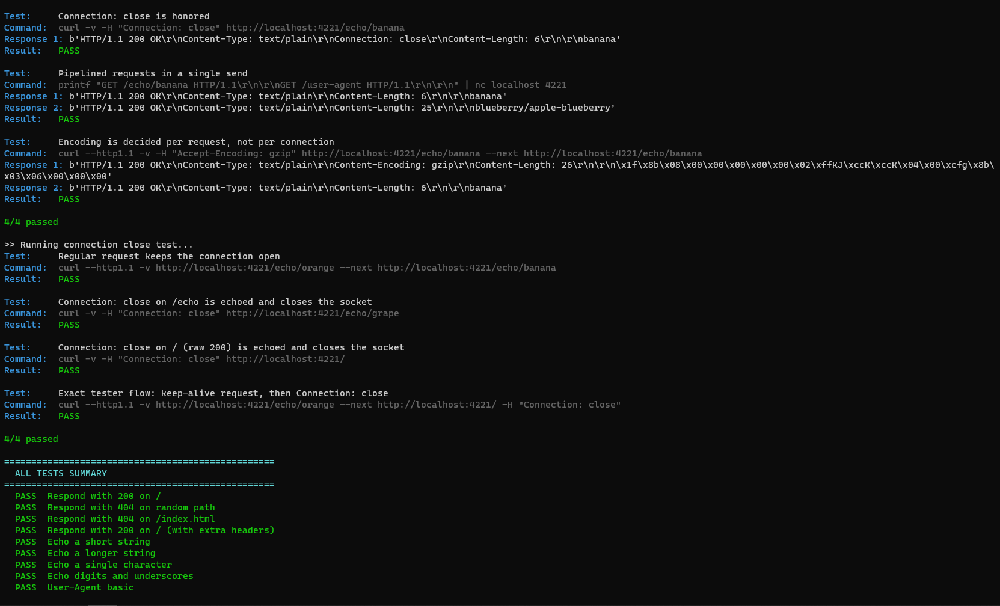

[](https://app.codecrafters.io/users/EhsanIC)

# http

A from-scratch HTTP/1.1 server in Python, using only standard-library sockets and no web frameworks.

## Features

- Raw TCP server on `localhost:4221`
- Routes: `GET /`, `GET /echo/{str}`, `GET /user-agent`, `GET /files/{filename}`, `POST /files/{filename}`; everything else returns `404`
- Optional `--directory <path>` sets the folder served by `/files`
- gzip compression with `Content-Encoding: gzip` when the request carries `Accept-Encoding: gzip`
- One thread per connection, each with private per-connection state
- Persistent connections: each socket handles many requests in a loop
- Request framing by `Content-Length`; leftover bytes stay in the buffer, so pipelined requests work
- `Connection: close` is echoed in the response and the socket is closed afterwards

## Project structure

```
http/
├── app/
│   ├── main.py                   # Entry point: accept loop, per-connection read loop, close handling
│   ├── request.py                # Request parsing and Content-Length framing
│   ├── handlers.py               # Route table and per-route logic
│   └── response.py               # Status lines, headers, bodies, gzip, Connection: close
├── test/
│   ├── helpers.py                # Reads exactly one response, framed by Content-Length
│   ├── test_client.py            # Routing, echo, and User-Agent responses
│   ├── test_files.py             # GET /files/{filename}
│   ├── test_post_files.py        # POST /files/{filename}
│   ├── test_concurrent.py        # Many connections at once while one stays idle
│   ├── test_persistent.py        # Keep-alive, pipelining, per-request encoding
│   └── test_connection_close.py  # Connection: close header and socket teardown
├── client_test.ps1               # Starts the server, runs every suite, prints a combined summary
├── your_program.sh               # Run script used locally and by CodeCrafters
└── docs/                         # Screenshots used in this README
```

## How it works

**Accept loop.** `main()` binds `localhost:4221` and starts a daemon thread for every accepted connection, so one slow client cannot block the others.

**Buffer and framing.** Each connection owns a byte buffer. `parse_request()` looks for `\r\n\r\n`, reads `Content-Length`, and returns `(raw, leftover)` only when the full body has arrived. Otherwise it returns `(None, buffer)` and the loop reads more. The leftover stays in the buffer, which is what makes pipelining work: two requests in one packet are handled as two separate requests.

**Handler.** A complete request is parsed into a `Request` (method, path, route, headers, body), looked up in `ROUTES`, and passed to the matching handler. The handler returns the response bytes. If the request had `Connection: close`, the header is added and the per-connection loop returns, closing the socket.

## Run locally

```sh
./your_program.sh
```

With a directory for `/files`:

```sh
./your_program.sh --directory ./test_files_dir
```

Or directly with `uv`:

```sh
uv run python -m app.main --directory ./test_files_dir
```

Submit:

```sh
codecrafters submit
```

## Try it with curl

Root:

```sh
curl -v http://localhost:4221/
```

Echo:

```sh
curl -v http://localhost:4221/echo/banana
```

User-Agent:

```sh
curl -v http://localhost:4221/user-agent -H "User-Agent: blueberry/apple"
```

Get a file:

```sh
curl -v http://localhost:4221/files/example.txt
```

Upload a file:

```sh
curl -v -X POST http://localhost:4221/files/example.txt \
  -H "Content-Type: application/octet-stream" --data-binary "hello"
```

gzip:

```sh
curl -v --compressed http://localhost:4221/echo/banana
```

Connection: close:

```sh
curl -v -H "Connection: close" http://localhost:4221/echo/banana
```

## Testing

### CodeCrafters stage tests


All official stages pass.

### Custom test client

`client_test.ps1` starts the server and runs raw-socket Python suites for routing, echo, User-Agent, file GET/POST, gzip, keep-alive, pipelining, concurrent connections, and `Connection: close`. It reads responses framed by `Content-Length` rather than waiting for the socket to close, then prints one combined summary.

```powershell
pwsh ./client_test.ps1
```



This test client was generated with AI.

## Authorship

The HTTP server in `app/` was written by me. AI was used for explanations and code review. The test client (`test/` and `client_test.ps1`) was generated with AI.

## What I learned

- How HTTP/1.1 is framed on the wire: TCP delivers a byte stream, and `Content-Length` — not packet boundaries — decides where one request ends.
- Why a per-connection buffer is required for keep-alive and pipelining; reading once per request breaks as soon as two requests share a packet.
- How connection lifecycle works: keep-alive by default, `Connection: close` to terminate, and per-request decisions on a socket that stays open.
- How to test a server at the socket level, including how to detect a real close instead of a hang.
